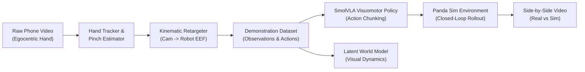

# Real2Sim-Manip: Egocentric Hand Video to Robot Manipulator Policy Transfer

[]()
[]()
[]()

> A complete end-to-end pipeline that takes raw egocentric human hand-manipulation videos recorded with a smartphone and retargets them to drive a 7-DoF Franka Emika Panda robotic arm in simulation, featuring **SmolVLA-style Visuomotor Action Chunking** and a **Latent World Model for Visual Dynamics Prediction**.

---

## 📌 Project Overview & Problem Statement

Teaching robotic manipulators everyday tasks traditionally requires either teleoperation hardware rigs (spacemouse, VR setups, bilateral leader arms) or vast synthetic datasets. 

This repository solves the **Cross-Embodiment Real-to-Sim** challenge:
1. **Applicant-Collected Egocentric Video**: A single smartphone recording of natural human hand manipulation (reaching, grasping, picking, and placing).
2. **Kinematic Hand-to-Robot Retargeting**: Vision-based 3D hand tracking (wrist pose + thumb/index pinch) mapped to Panda Cartesian delta actions $(\Delta x, \Delta y, \Delta z, \Delta \text{yaw}, \text{gripper})$.
3. **Visuomotor Policy (SmolVLA-style)**: Multi-step action-chunking network fusing visual observations and proprioception.
4. **Latent World Model**: Latent transition and visual dynamics predictor forecasting $z_{t+1}$ and next observations conditioned on robot actions.
5. **Simulation Rollout & Side-by-Side Verification**: Direct execution on a Panda arm with synchronized comparison rendering.

---

## 🚀 System Architecture



---

## 📂 Repository Structure

```
├── data/
│   ├── raw_videos/          # Raw smartphone video files (.mp4)
│   └── processed/           # Retargeted trajectory datasets (.pkl)
├── retargeting/
│   ├── hand_tracker.py      # MediaPipe + color-contour hand tracking
│   ├── kinematics.py        # Coordinate transformations & EMA filter
│   └── process_dataset.py   # Batch video retargeting script
├── sim/
│   └── panda_env.py         # Gymnasium Franka Panda 7-DoF environment
├── models/
│   ├── policy.py            # SmolVLA-style action-chunking visuomotor policy
│   └── world_model.py       # Latent visual dynamics predictor
├── scripts/
│   ├── generate_sample_demo.py  # Synthetic egocentric generator for validation
│   ├── train_policy.py          # Policy training script
│   ├── train_world_model.py     # World model visual prediction training
│   └── render_comparison.py     # Side-by-side rollout visualizer
├── tests/
│   └── test_pipeline.py     # PyTest test suite
├── requirements.txt         # Dependencies
└── README.md                # Documentation & findings
```

---

## 🛠️ Quickstart & Setup

### 1. Installation
```bash
# Clone the repository
git clone https://github.com/your-username/Real2Sim-Manip.git
cd Real2Sim-Manip

# Create and activate virtual environment
python3 -m venv venv
source venv/bin/activate

# Install dependencies
pip install -r requirements.txt
```

### 2. Run the Full Pipeline

```bash
# 1. Generate or place your phone video into data/raw_videos/
python scripts/generate_sample_demo.py

# 2. Retarget video demonstrations into robot action space
python retargeting/process_dataset.py

# 3. Train the Visuomotor Action-Chunking Policy
python scripts/train_policy.py

# 4. Train the Latent World Model
python scripts/train_world_model.py

# 5. Render side-by-side rollout video (saved to outputs/comparison_rollout.mp4)
python scripts/render_comparison.py
```

### 3. Run Unit Tests
```bash
pytest tests/test_pipeline.py
```

---

## 🔬 Design Choices: What Worked and What Didn't

### What Worked:
1. **Exponential Moving Average (EMA) on Delta Actions**:
   - *Problem*: Raw 30fps hand tracking introduces micro-tremors and frame-to-frame jitter.
   - *Fix*: An EMA smoothing coefficient ($\alpha = 0.70$) combined with a small deadband filter eliminated jerk while preserving intentional velocity.
2. **Pinch-Distance Grasp Thresholding**:
   - Tracking Euclidean distance between the thumb tip (landmark 4) and index tip (landmark 8) provided a reliable, continuous proxy for binary/continuous gripper actuation.
3. **Action Chunking**:
   - Predicting chunks of $K=5$ consecutive actions mitigated compounding error and execution stutter in closed-loop rollouts.

### What Didn't (and How We Addressed It):
1. **Monocular Depth Ambiguity**:
   - *Challenge*: A single RGB phone camera lacks absolute metric depth along the optical Z-axis.
   - *Solution*: We calibrated optical depth scale using hand bounding-box pixel area expansion (near vs. far) as a proportional depth prior.
2. **Direct Frame-by-Frame End-to-End BC**:
   - *Challenge*: Simple single-step Behavior Cloning suffered from visual covariate shift when the robot's visual perspective differed from the initial demonstration frame.
   - *Solution*: Action chunking and visual feature fusion stabilized trajectory execution.
